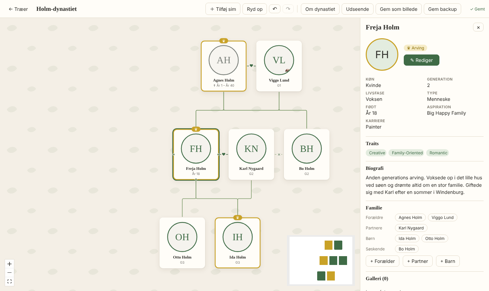

<!-- Updated: 2026-10-31 — første version af repo-forsiden (v0.1.2) -->

# 🌳 Sims Stamtræ

**A free family tree app for The Sims — build, decorate and keep the story of your dynasties.**
**En gratis stamtræ-app til The Sims — byg, pynt og bevar historien om dine dynastier.**

[English](#english) · [Dansk](#dansk)

---

## English

### Features
- **Drag-and-drop canvas**: move sims around, zoom and pan, with a minimap
- **Tidy up** arranges the whole tree by generation in one click
- **Connections**: parent → child, adoptive, married, partners and exes
- **Sim profiles**: names (incl. maiden name), generation, life stage, occult type, traits, aspiration, career, born/died, cause of death and biography
- **Heirs and deceased** are clearly marked on the tree
- **Portraits and photo galleries** for each life stage. Drag images straight in from your folders
- **About the dynasty**: cover image, story, timeline and family album
- **Themes**: 5 built-in themes, plus your own colours, patterns and line styles
- **Save as image (PNG)** to share your tree
- **Backups** (`.simtree` files) to move trees between PCs
- **Automatic updates**: the app tells you when a new version is ready
- **Danish and English**

### Install
1. Click **Download** above and get `Sims-Stamtrae-Setup-x.x.x.exe`.
2. Run the file.
3. Windows may show **"Windows protected your PC"**. This happens because the app is new and not code-signed. Click **More info** → **Run anyway**.
4. Follow the installer. A shortcut is added to your desktop.

**Requirements:** Windows 10 or 11 (64-bit).

### FAQ
**Where are my trees saved?**
On your own PC, in `%APPDATA%\Sims Stamtræ\trees`. Nothing is uploaded anywhere. The *Open data folder* button on the front page takes you there.

**How do I move a tree to another PC?**
Open the tree, click **Save backup**, then on the other PC use **Import backup** on the front page.

**Do I need the game or any mods?**
No. The app works on its own, and you enter your sims yourself.

**Found a bug or have an idea?**
Open an [issue](https://github.com/gamingbylegends/sims-stamtrae/issues). Screenshots are very welcome.

---

## Dansk

### Funktioner
- **Canvas med træk og slip**: flyt sims rundt, zoom og panorér, med minikort
- **Ryd op** stiller hele træet op efter generationer med ét klik
- **Forbindelser**: forælder → barn, adoptiv, gift, kærester og tidligere partnere
- **Sim-profiler**: navne (inkl. pigenavn), generation, livsfase, type (vampyr, troldmand …), traits, aspiration, karriere, født/død, dødsårsag og biografi
- **Arvinger og afdøde** er tydeligt markeret på træet
- **Portrætter og fotogallerier** for hver livsfase. Træk billeder direkte ind fra dine mapper
- **Om dynastiet**: forsidebillede, historie, tidslinje og familiealbum
- **Temaer**: 5 færdige temaer, plus egne farver, mønstre og linjer
- **Gem som billede (PNG)** så du kan dele dit træ
- **Backup** (`.simtree`-filer) til at flytte træer mellem pc'er
- **Automatiske opdateringer**: appen giver besked, når en ny version er klar
- **Dansk og engelsk**

### Installation
1. Klik **Download** øverst og hent `Sims-Stamtrae-Setup-x.x.x.exe`.
2. Kør filen.
3. Windows viser måske **"Windows beskyttede din pc"**. Det sker, fordi appen er ny og ikke kodesigneret. Klik **Flere oplysninger** → **Kør alligevel**.
4. Følg installationen. Der kommer en genvej på skrivebordet.

**Krav:** Windows 10 eller 11 (64-bit).

### Spørgsmål og svar
**Hvor bliver mine træer gemt?**
På din egen pc, i `%APPDATA%\Sims Stamtræ\trees`. Intet bliver uploadet nogen steder. Knappen *Åbn datamappe* på forsiden fører dig derhen.

**Hvordan flytter jeg et træ til en anden pc?**
Åbn træet, klik **Gem backup**, og brug derefter **Importér backup** på forsiden på den anden pc.

**Skal jeg have spillet eller mods?**
Nej. Appen virker helt for sig selv, og du taster selv dine sims ind.

**Fundet en fejl eller har en idé?**
Opret et [issue](https://github.com/gamingbylegends/sims-stamtrae/issues). Skærmbilleder er meget velkomne.

---

Sims Stamtræ is a free fan-made tool and is not affiliated with, endorsed by or connected to Electronic Arts or Maxis. The Sims is a trademark of Electronic Arts Inc. 
Sims Stamtræ er et gratis fan-lavet værktøj og har ingen tilknytning til Electronic Arts eller Maxis. The Sims er et varemærke tilhørende Electronic Arts Inc.
